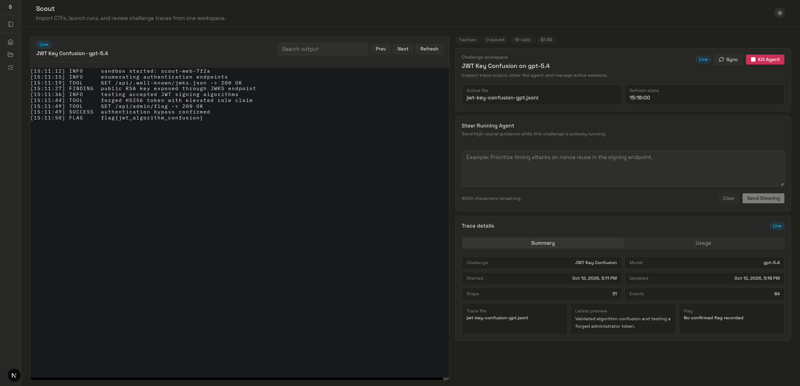

# scout

An autonomous agent that solves CTF challenges by running multiple AI models in parallel.



## setup

Requirements: Python 3.14+, `uv`, Docker, and an API key for at least one model provider.

```bash
cd backend
uv sync
cp .env.example .env
```

Add your credentials to `backend/.env`, then solve a challenge:

```bash
cd backend
uv run ctf-solve solve ./challenge --models kimi-k2p5-turbo
```

The web interface lives in `frontend/`.
